# 🔩 Metal Surface Defect Classification — 딥러닝 기반 금속 표면 불량 유형 분류

> 금속 표면 이미지 1,800장으로 **6종 결함을 분류하는 CNN**을 학습하고, 평균 정확도 뒤에 숨은 **클래스별 약점과 오분류를 분석**한 뒤, **Grad-CAM으로 모델이 참고한 영역**을 확인해 Streamlit 웹앱으로 배포한 판독 보조 프로토타입

| 항목 | 내용 |
|---|---|
| 기간 | 2026.11.03 ~ 2026.11.05 |
| 소속 | 휴먼AI교육센터 · 인공지능(AI)서비스 기반 웹 개발자 심화 과정 딥러닝 프로젝트 |
| 인원 | 1명 (개인 프로젝트) |
| 역할 | 데이터 분석 · CNN 설계와 학습 · 평가와 오분류 분석 · Grad-CAM · 경량화 비교 실험 · Streamlit 웹앱과 배포 전체 |
| 배포 | [Streamlit 웹앱 바로가기](https://metal-surface-defect-nanmcuhpbmfgmsbcajwknc.streamlit.app/) |
| 발표자료 | [프로젝트 발표자료 (PDF, 31쪽)](docs/금속표면불량분류_발표자료.pdf) |
| 데이터 | NEU Surface Defect Database (NEU-CLS) |

## 🚀 바로가기

| 구분 | 링크 |
|---|---|
| 웹앱 (Streamlit Cloud) | https://metal-surface-defect-nanmcuhpbmfgmsbcajwknc.streamlit.app/ |
| 발표자료 | [docs/금속표면불량분류_발표자료.pdf](docs/금속표면불량분류_발표자료.pdf) — 분석 과정 · 그래프 · 실험 세부 결과 |
| 분석 노트북 | [metal_defect.ipynb](metal_defect.ipynb) — 데이터 분석부터 Grad-CAM까지 |
| 비교 실험 노트북 | [model_comparison.ipynb](model_comparison.ipynb) — Baseline CNN vs GAP CNN |

> 웹앱에 금속 표면 이미지(PNG · JPG · BMP)를 최대 20장까지 올리면 결함 유형, 클래스별 예측 확률, Grad-CAM 결과를 바로 확인할 수 있습니다.

## 목차

| # | 구분 | 내용 |
|---|---|---|
| 01 | 프로젝트 개요 | 배경 · 문제 정의 · 목표 · 범위 |
| 02 | 데이터 분석 | 데이터 구성 · EDA · 전처리와 분할 |
| 03 | 모델 개발 | Baseline CNN 설계 · 학습 설정 · 학습 결과 |
| 04 | 평가와 오분류 분석 | 독립 테스트 성능 · 혼동행렬 · 클래스별 성능 · 스크래치 오분류 |
| 05 | Grad-CAM | 정답 예측과 오분류 예측의 관심 영역 |
| 06 | 추가 실험 | GAP CNN 경량화 비교 · 최종 모델 판단 |
| 07 | 웹앱과 배포 | Streamlit 화면 · Community Cloud 배포 |
| 08 | 결론 및 회고 | 결과 · 트러블슈팅 · 한계 · 배운 점 |

---

# 01. 프로젝트 개요

## 1.1 추진 배경

금속 표면 결함은 유형마다 형태와 질감이 다르지만, 균열과 스크래치처럼 비슷한 **선형 흔적**이 나타나는 유형도 있습니다. 이런 유형을 사람이 일일이 구분하려면 시간이 들고, 모델로 분류하더라도 **평균 정확도만으로는 어떤 유형에서 틀리는지** 알기 어렵습니다.

| 분석이 필요한 문제 | 프로젝트의 접근 |
|---|---|
| 유형 간 비슷한 형태 · 질감 | CNN의 공간적 특징 학습 |
| 평균 정확도만으로 취약점 파악이 어려움 | 클래스별 지표 · 혼동행렬 분석 |
| 모델이 참고한 영역을 확인할 필요 | Grad-CAM 기여도 시각화 |

## 1.2 프로젝트 목표

**6종 결함 분류 모델을 구현하고, 성능 · 오류 · 예측 기여 영역을 함께 분석한다.**

## 1.3 범위

| 구분 | 내용 |
|---|---|
| 포함 | EDA · 전처리, CNN 학습 · 평가, 오분류 · Grad-CAM 분석, GAP 경량화 비교, Streamlit 웹앱 · 배포 |
| 제외 | 정상 · 불량 이진 판정, 결함 좌표 · 면적 검출, 생산라인 카메라 연동 |

---

# 02. 데이터 분석

## 2.1 데이터 구성

| 항목 | 내용 |
|---|---|
| 데이터셋 | NEU Surface Defect Database (NEU-CLS) |
| 전체 이미지 | 1,800장 (클래스별 300장, 균형) |
| 이미지 형식 | 200×200 흑백 BMP |

| 코드 | 결함 클래스 | 한글명 | 특징 |
|---|---|---|---|
| Cr | Crazing | 균열 | 선형 흔적 |
| In | Inclusion | 개재물 | 점 · 영역 · 긴 흔적 |
| Pa | Patches | 패치 | 국소 영역 |
| PS | Pitted Surface | 표면 패임 | 반복 패임 질감 |
| RS | Rolled-in Scale | 압연 스케일 | 불규칙 스케일 질감 |
| Sc | Scratches | 스크래치 | 방향성 있는 선 |

<p align="center">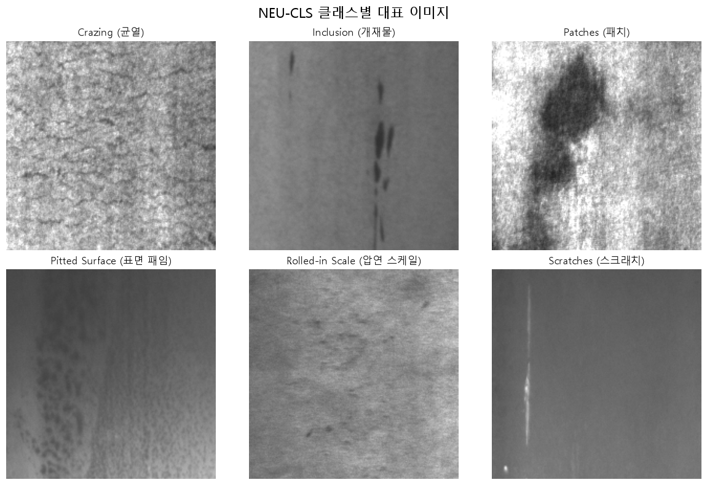</p>

## 2.2 EDA 주요 발견

| 관찰 | 의미 |
|---|---|
| 클래스별 300장으로 균형 | 클래스 불균형 보정 없이 학습 가능 |
| 결함마다 형태 · 질감의 **공간적 차이**가 큼 | 합성곱 기반 CNN으로 특징을 학습하기로 결정 |
| 일부 유형은 비슷한 선형 흔적과 밝기 구간을 가짐 | 균형 데이터여도 특정 유형은 헷갈릴 수 있음 → 클래스별 분석 필요 |

> 픽셀 밝기 분포는 전체 통계가 아닌 클래스별 대표 이미지 기준으로 비교했습니다.

## 2.3 전처리와 데이터 분할

| 단계 | 내용 |
|---|---|
| 타입 변환 | uint8 → float32 |
| 정규화 | 0\~255 ÷ 255 → 0\~1 |
| 입력 차원 | (200, 200, 1) |
| 분할 | 계층화 분할로 클래스 비율 유지 (random_state=42) |

| 데이터 | 이미지 수 | 비율 | 클래스별 | 역할 |
|---|---|---|---|---|
| Train | 1,260 | 70% | 210 | 가중치 학습 |
| Validation | 270 | 15% | 45 | 학습 과정 확인 · 최적 모델 선택 |
| Test | 270 | 15% | 45 | **모델 확정 후 한 번만** 최종 평가 |

---

# 03. 모델 개발

## 3.1 Baseline CNN 구조

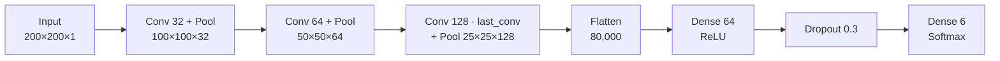

| 항목 | 내용 |
|---|---|
| Conv2D | 3×3 · same · ReLU, 선 · 경계 · 질감 특징 추출 |
| last_conv | Pooling 전 50×50×128, **Grad-CAM의 특징 맵**으로 사용 |
| 총 파라미터 | 5,213,126개 |

## 3.2 학습 설정

| 구분 | 설정 |
|---|---|
| 최적화 | Adam, Learning Rate 0.001, Sparse Categorical Crossentropy |
| 반복 | Batch Size 32, 최대 20 Epoch |
| 과적합 완화 | Dropout 0.3, EarlyStopping(val_loss, patience=4) |
| 모델 선택 | `restore_best_weights=True`로 **최저 검증 손실** 가중치 복원 |

## 3.3 학습 결과

| 항목 | 결과 |
|---|---|
| 학습 | 20 Epoch 완료 |
| 선택 모델 | **Epoch 17** (최저 Validation Loss 0.1850) |
| Validation Accuracy | **94.44%** |
| 저장 | `models/cnn_model.keras`, 지표는 `models/model_info.json` |

<p align="center">
  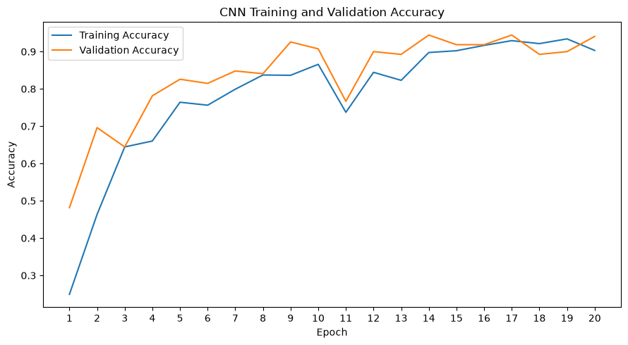
  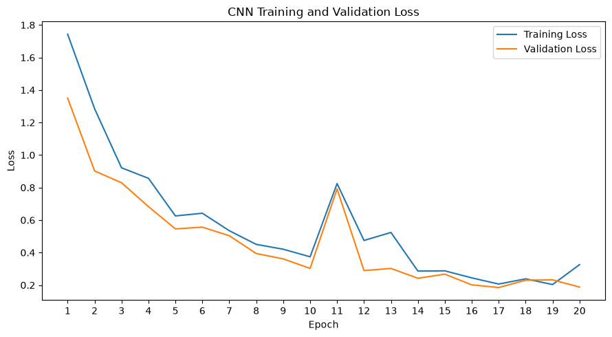
</p>

> Epoch 11에서 정확도가 일시적으로 떨어졌다가 회복했습니다. 마지막 Epoch가 아니라 **검증 손실이 가장 낮은 Epoch 17**의 가중치를 최종 모델로 사용했습니다.

---

# 04. 평가와 오분류 분석

## 4.1 독립 테스트 성능

모델 선택에 쓰지 않은 **Test 270장**으로 한 번만 평가했습니다.

| 평가 지표 | 결과 |
|---|---|
| Accuracy | **0.9333 (93.33%)** — 정답 252장 / 오분류 18장 |
| Loss | 0.1542 |
| Macro Precision | 0.9376 |
| Macro Recall | 0.9333 |
| Macro F1-score | **0.9328** |

> 검증 정확도 94.44%보다 테스트 정확도가 1.11%p 낮았습니다.

## 4.2 혼동행렬과 클래스별 성능

<p align="center">
  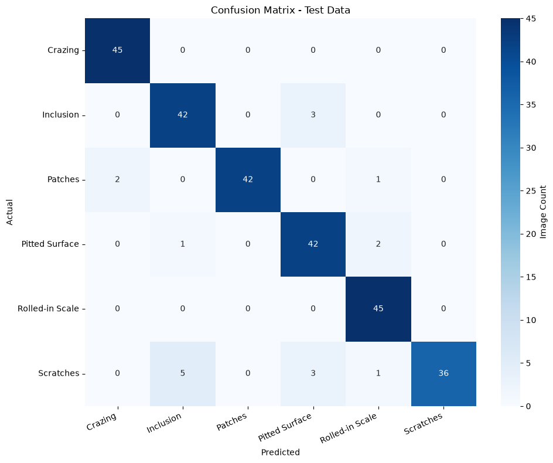
</p>
<p align="center">
  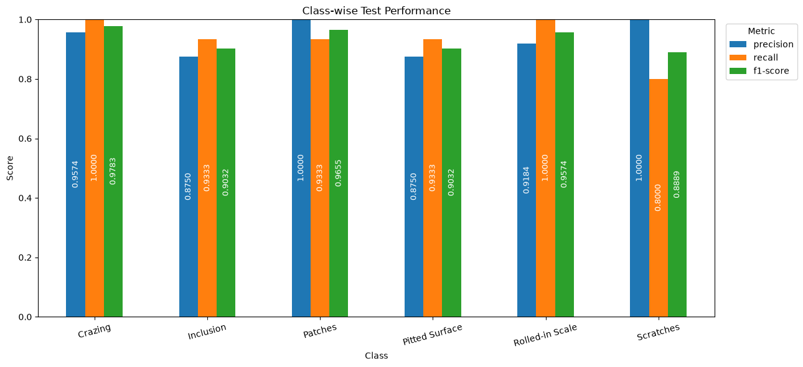
</p>

| 관찰 | 내용 |
|---|---|
| 완벽 분류 | Crazing · Rolled-in Scale 45/45 |
| 가장 약한 클래스 | **Scratches Recall 80.00%** (45장 중 36장 정답) |
| Scratches 오분류 9장 | Inclusion 5장 · Pitted Surface 3장 · Rolled-in Scale 1장 |
| 비중 | 전체 오류 18건 중 **절반이 Scratches** |

**전체 정확도는 93.33%였지만, 스크래치의 재현율은 80%에 그쳤습니다.** 평균 지표만 봤다면 놓쳤을 약점입니다.

## 4.3 스크래치를 개재물로 예측한 사례

<p align="center">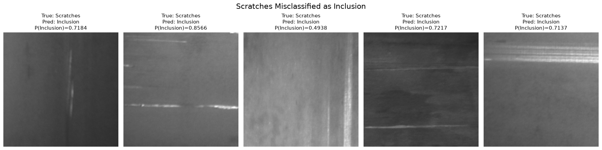</p>

- 선형 긁힘과 함께 주변의 불규칙한 질감이나 어두운 영역이 보이는 이미지가 많았습니다.
- Inclusion 예측 확률은 0.4938 ~ 0.8566이었습니다.
- 이 사례들을 골라 Grad-CAM으로 모델이 어느 영역을 참고했는지 추가로 확인했습니다.

---

# 05. Grad-CAM

마지막 합성곱 층 `last_conv`의 특징 맵과 예측 클래스의 기울기로 **예측에 기여한 영역**을 시각화했습니다.

## 5.1 정답 예측의 관심 영역

<p align="center">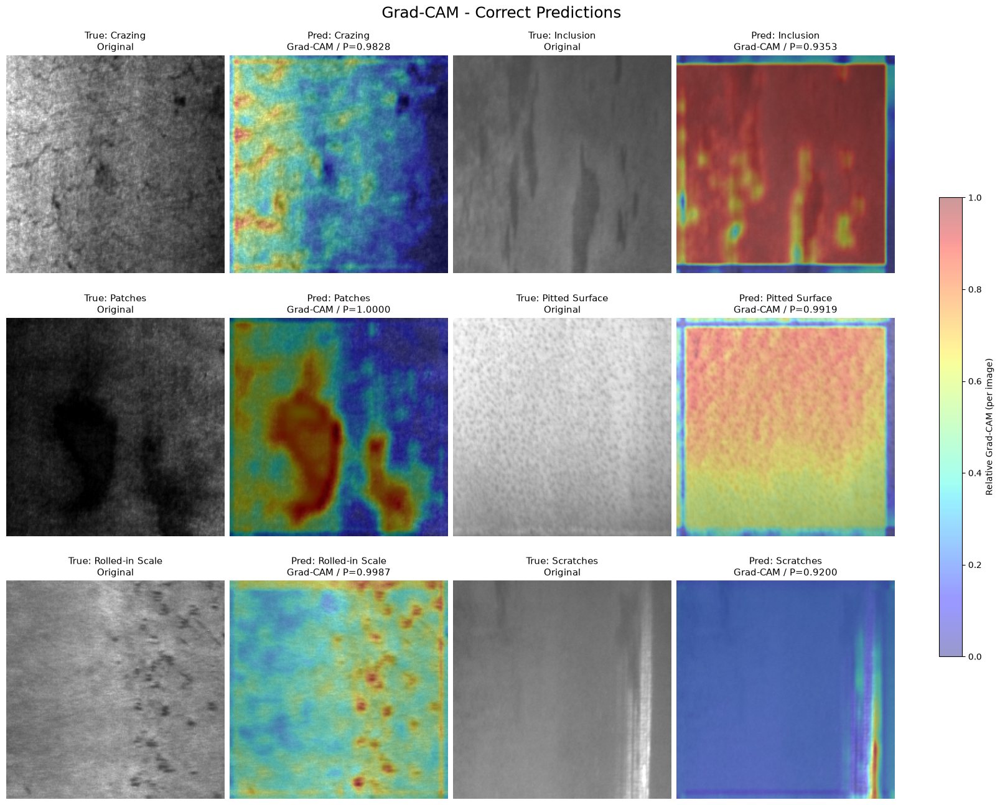</p>

| 클래스 | 확률 | 관찰 |
|---|---|---|
| Patches | 100.00% | 어두운 패치 영역에 기여도 집중 |
| Rolled-in Scale | 99.87% | 점 형태의 스케일 위치에 기여도 분포 |
| Scratches | 92.00% | 밝은 세로선 주변에 높은 기여도 |
| Inclusion · Pitted Surface | 93.53% · 99.19% | 넓은 표면 영역에 기여도 분포 |

## 5.2 오분류 이미지의 관심 영역

<p align="center">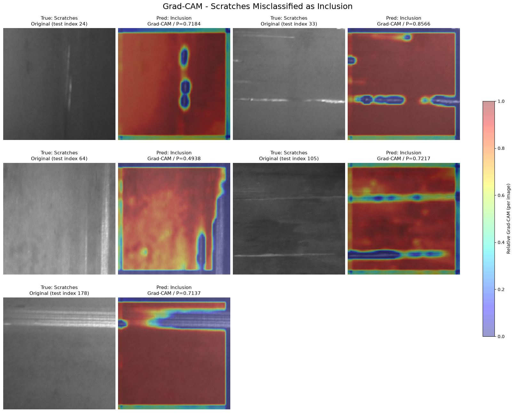</p>

- 실제 Scratches를 Inclusion으로 예측한 이미지에서는 **밝은 선 자체의 기여도는 낮고, 주변 배경에 넓은 관심 영역**이 나타났습니다.
- 모델이 긁힘보다 주변 표면 질감을 근거로 판단했을 가능성을 보여 줍니다.

> Grad-CAM은 이미지별 **상대 기여도**를 보여 주는 탐색적 참고 자료입니다. 실제 결함 위치 검출 결과가 아니며, 시각화만으로 오분류의 인과적 원인을 확정하지 않았습니다.

---

# 06. 추가 실험 — CNN 경량화 비교

## 6.1 실험 설계

Flatten을 **GlobalAveragePooling2D(GAP)** 로 바꾸면 성능을 유지하면서 모델을 가볍게 만들 수 있는지 확인했습니다. 특징 추출부와 분류기, 학습 설정은 같게 두고 **동일한 Validation 270장**으로 비교했습니다. Test 데이터는 이 비교와 추가 학습에 사용하지 않았습니다.

| 모델 | 특징 벡터 | 파라미터 |
|---|---|---|
| Baseline CNN | Flatten 80,000개 | 5,213,126 |
| GAP CNN | GAP 128개 | 101,318 (**약 98.06% 감소**) |

## 6.2 비교 결과

| 지표 | Baseline CNN | GAP CNN | 변화 |
|---|---|---|---|
| Validation Accuracy | **94.44%** | 90.37% | −4.07%p |
| Validation Loss | **0.1850** | 0.2640 | +0.0790 |
| Validation Macro F1 | **0.9449** | 0.9044 | −0.0405 |
| 오분류 건수 | **15장** | 26장 | +11장 |
| 학습 시간 (참고) | 664.35초 | 565.98초 | 약 −14.8% |

<p align="center">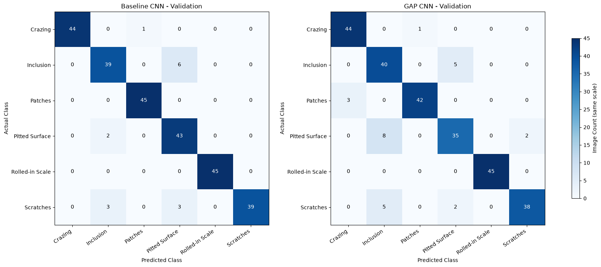</p>
<p align="center">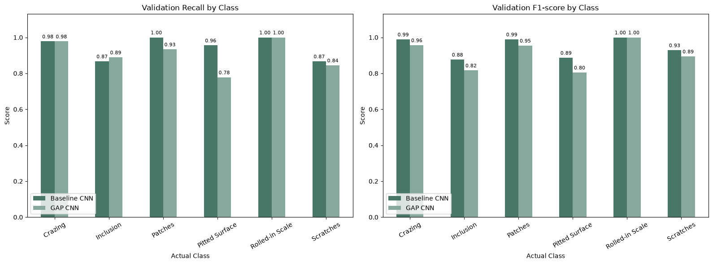</p>

| 관찰 | 내용 |
|---|---|
| 가장 큰 하락 | **Pitted Surface Recall 95.56% → 77.78%** (43장 → 35장 정답) |
| 늘어난 혼동 | Pitted Surface → Inclusion 2건 → 8건, Scratches → Inclusion 3건 → 5건 |
| Recall과 F1의 차이 | Inclusion Recall은 86.67% → 88.89%로 올랐지만 F1은 0.8764 → 0.8163으로 하락 |

> 학습 시간은 서로 다른 실행 시점의 측정값이라 참고로만 봅니다. 추론 속도 향상 여부는 검증하지 않았습니다.

## 6.3 최종 판단 — Baseline CNN 유지

GAP CNN은 파라미터를 약 98% 줄였지만 검증 정확도가 4.07%p 떨어졌고, 특히 표면 패임의 재현율이 크게 하락했습니다. **분류 성능을 우선해 Baseline CNN을 유지**하고 웹앱에 적용했습니다.

---

# 07. 웹앱과 배포

## 7.1 Streamlit 웹앱

<p align="center">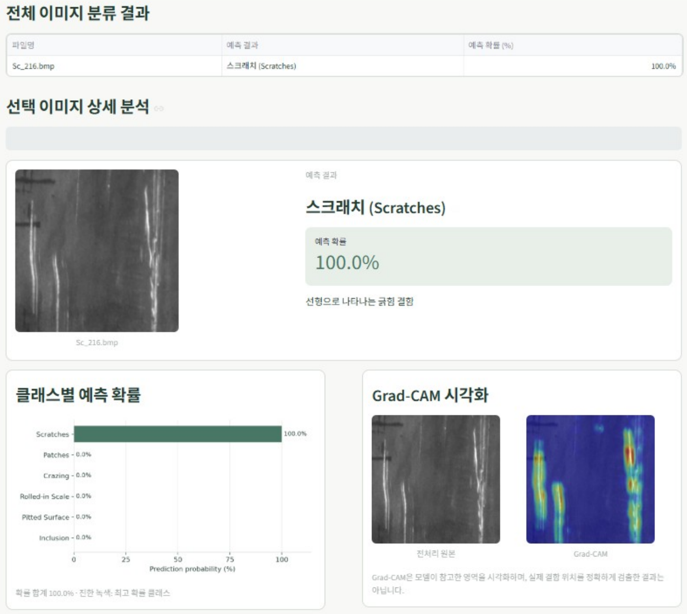</p>

| 기능 | 내용 |
|---|---|
| 이미지 업로드 | PNG · JPG · JPEG · BMP, **최대 20장** 일괄 분류 |
| 분류 결과 | 결함 유형(한글 · 영문)과 예측 확률 표 |
| 상세 분석 | 선택 이미지의 클래스별 예측 확률 그래프 |
| Grad-CAM | 전처리 원본과 Grad-CAM 오버레이를 나란히 표시 |
| 사용 범위 안내 | 정상 제품 판별 불가, Softmax 확률과 Grad-CAM의 해석 한계 표시 |

> 화면 예시의 100.0%는 해당 이미지 한 장의 예측 확률이며, 모델의 독립 Test 정확도는 93.33%입니다.

## 7.2 배포


| 항목 | 구성 |
|---|---|
| 배포 플랫폼 | Streamlit Community Cloud |
| Python | 3.11 |
| 모델 파일 | `models/cnn_model.keras` |

---

# 08. 결론 및 회고

## 8.1 결과 요약

| 항목 | 결과 |
|---|---|
| 최종 모델 | Baseline CNN (Epoch 17, Validation Accuracy 94.44%) |
| 독립 Test | **Accuracy 93.33%**, Macro F1 0.9328 |
| 확인한 약점 | Scratches Recall 80.00%, 주로 Inclusion으로 오분류 |
| 판단 근거 시각화 | Grad-CAM으로 정답 · 오분류 이미지의 관심 영역 비교 |
| 경량화 실험 | GAP로 파라미터 98.06% 감소, 검증 정확도 4.07%p 하락 → Baseline 유지 |
| 서비스 | Streamlit 판독 보조 프로토타입 공개 배포 |

## 8.2 트러블슈팅

### ① 평균 정확도 뒤에 숨은 스크래치 오분류

| 구분 | 내용 |
|---|---|
| 문제 | 전체 Test 정확도는 93.33%로 높았지만, 어떤 유형이 약한지는 보이지 않음 |
| 원인 | 평균 지표는 클래스별 편차를 가림 |
| 해결 | 혼동행렬 · 클래스별 지표로 Scratches Recall 80% 확인 → 오분류 이미지 확인 → Grad-CAM으로 관심 영역 비교 |
| 결과 | 오류 18건 중 9건이 Scratches이며, 주변 질감에 기여도가 몰린 사례를 찾음 |

### ② 배포 시 TensorFlow 설치 오류

| 구분 | 내용 |
|---|---|
| 문제 | Streamlit Community Cloud에서 TensorFlow 패키지 설치 오류 발생 |
| 해결 | 배포 환경의 Python 버전을 3.11로 변경 |
| 결과 | 정상 배포 |

## 8.3 한계와 향후 과제

| 항목 | 현재 한계 | 향후 검토 방향 |
|---|---|---|
| Scratches 낮은 Recall | Test Recall 80.00% (45장 중 9장 오분류) | 다양한 스크래치 형태 · 표면 질감 데이터 확보 및 증강 검토 |
| GAP 경량화 시 성능 감소 | Val Accuracy 4.07%p 하락, PS Recall 95.56% → 77.78% | 특징 추출 계층 보완, BatchNormalization 등으로 성능 · 경량화 균형 검토 |
| 클래스 간 시각적 유사성 | Scratches와 Inclusion 등 일부 유형 혼동 | 혼동 클래스의 이미지 특징 추가 분석, 데이터 다양성 확보 |
| 정상 제품 클래스 부재 | 정상 · 미학습 이미지도 6개 결함 중 하나로 분류되며 높은 확률이 표시될 수 있음 | 정상 이미지 확보, 정상 / 불량 구분과 불확실성 처리 방법 검토 |
| 실제 제조 환경 검증 부족 | NEU-CLS 기준으로만 평가 | 실제 현장 이미지로 일반화 성능 평가 |
| 촬영 조건 변화 | 조명 · 각도 · 카메라 · 노이즈별 성능 미검증 | 촬영 조건을 다양화한 데이터로 강건성 확인 |

> 위 개선안은 후속 검토 사항이며, 실제 효과는 별도 실험으로 검증해야 합니다. 현재 시스템은 **NEU-CLS 기반 판독 보조 프로토타입**입니다.

## 8.4 배운 점

- **데이터 분석:** 클래스별 이미지 수가 균형이어도 결함의 형태나 질감이 비슷하면 분류가 어려울 수 있었습니다. 모델을 만들기 전에 데이터 특성을 충분히 살펴보는 과정이 중요하다는 것을 알게 됐습니다.
- **모델 평가:** 전체 정확도만이 아니라 클래스별 성능과 혼동행렬을 함께 봐야 약점이 보였습니다.
- **모델 비교:** 파라미터를 98% 줄여도 정확도가 떨어지면 의미가 줄어들었습니다. 모델을 고를 때는 성능과 효율을 함께 따져야 한다는 것을 배웠습니다.
- **웹앱 구현:** 라이브러리 호환성과 화면 표시 문제를 해결하며, 실제로 쓸 수 있는 결과물에는 모델 성능뿐 아니라 배포 환경과 사용자 화면도 중요하다는 것을 느꼈습니다.

---

## 로컬 실행 방법

```bash
# 1. 가상환경 생성 및 패키지 설치
python -m venv .venv
source .venv/bin/activate        # Windows: .venv\Scripts\activate
pip install -r requirements.txt

# 2. 웹앱 실행 (저장된 models/cnn_model.keras 사용)
streamlit run app.py
```

노트북을 다시 실행하려면 NEU-CLS 원본 이미지를 `data/NEU/NEU-CLS/` 아래에 두어야 합니다. 원본 데이터셋은 저장소에 포함하지 않았습니다(`.gitignore`).

| 구분 | 버전 |
|---|---|
| 로컬 개발 | TensorFlow 2.21.0 / Keras 3.15.1 |
| 배포 | Python 3.11 |

## 프로젝트 구조

```
metal-surface-defect/
├── app.py                     # Streamlit 웹앱 (분류 · 확률 · Grad-CAM)
├── metal_defect.ipynb         # EDA → 전처리 → CNN 학습 → 평가 → 오분류 → Grad-CAM
├── model_comparison.ipynb     # Baseline CNN vs GAP CNN 비교 실험
├── models/
│   ├── cnn_model.keras        # 최종 모델 (Baseline CNN)
│   ├── cnn_gap_model.keras    # 비교 실험용 GAP CNN
│   └── model_info.json        # 클래스 정보 · 검증 · 테스트 지표
├── docs/
│   ├── 금속표면불량분류_발표자료.pdf
│   └── images/                # README 그래프 · 화면
├── requirements.txt
└── .devcontainer/
```

## 기술 스택

| 구분 | 기술 |
|---|---|
| 언어 · 환경 | Python, Jupyter Notebook |
| 딥러닝 | TensorFlow · Keras (CNN, Grad-CAM) |
| 데이터 처리 | NumPy, pandas, scikit-learn, Pillow |
| 시각화 | Matplotlib, seaborn |
| 웹앱 · 배포 | Streamlit, Streamlit Community Cloud, GitHub |

## 데이터 출처

- **NEU Surface Defect Database (NEU-CLS)** — Northeastern University(중국)에서 공개한 열연 강판 표면 결함 이미지 데이터셋
- K. Song, Y. Yan, "A noise robust method based on completed local binary patterns for hot-rolled steel strip surface defects", *Applied Surface Science*, 285, 2013.
